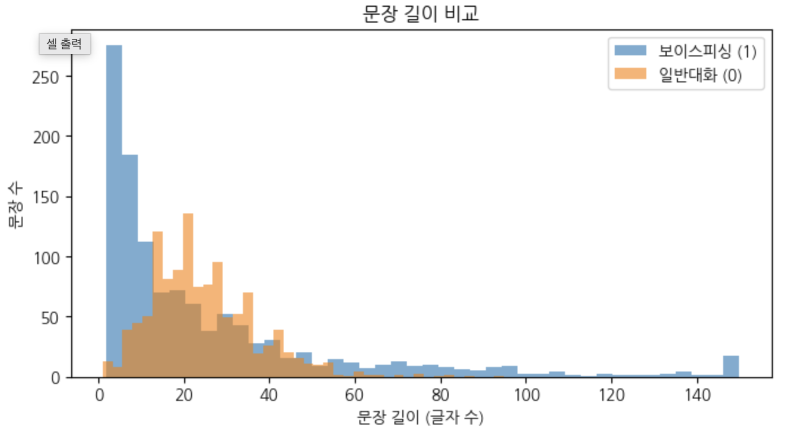

# 📞 Voicephishing Detection(2025.04~2025.10)

## 🛜 HuggingFace URL
링크로 들어가시면 해당 프로젝트의 데모를 확인할 수 있습니다! (첫 접속 시 다소 시간이 걸릴 수 있습니다)  
https://huggingface.co/spaces/Lilju/voicephishing_detection

## 📌 Project Overview
본 프로젝트는 음성 데이터를 텍스트로 변환한 뒤, KoBERT 기반 자연어처리 모델을 이용하여 보이스피싱 여부를 분류하는 AI 프로젝트입니다.

음성 데이터는 STT(Speech-to-Text)를 통해 텍스트로 변환한 후, KoBERT 분류 모델을 학습시켜 사용자가 업로드 한 음성데이터의 보이스피싱 여부를 분류하고 그 정도를 예측합니다.

## 📚 My Role(4인 팀)
- 데이터 수집 및 정제
- 웹페이지 디자인(html, css)
- flask 서버 연결

## 🎯 Project Objectives
- 보이스피싱 분류 모델 구축
- 단순한 키워드 탐지가 아닌 대화의 문맥을 분석하는 시스템 구현
- 다양한 보이스피싱 유형에 대응할 수 있는 시스템 구현
	
## 🛠️ Tech Stack
### Language
- Python

### AI/Deep Learning
- PyTorch
- KoBERT
- Hugging Face Transformers

## Dataset
데이터는 금융감독원에 업로드 되어있는 실제 보이스피싱 사례 음성 데이터와 국립국어원의 언어정보나눔터 일상대화 말뭉치를 수집하여 각각을 보이스피싱 데이터와 일반대화 데이터로 구성했습니다.

보이스피싱 데이터: 음성데이터를 줄 단위로 나눠 라벨링(1: 보이스피싱, 0: 보이스피싱x)
| columns | rows |
|---|---|
| 2 | 1840 |

일반대화 데이터
| columns | rows |
|---|---|
|2|728281|

최종 데이터(balanced): 3030
(보이스피싱: 1515, 일반대화데이터: 1515)

### Data Processing
- 데이터 정제
- 클래스 불균형 해소를 위해 일반 대화 데이터를 동일한 개수로 샘플링
- 데이터 셔플
- Train/Validation/Test 분할 (8:1:1)

## 🤖 Model
- KoBERT(skt/kobert-base-v1)

### Hyperparameters
|	Parameter	|	Value	|
|---|---|
|	Epoch	|	5	|
|	Learning Rate	|	5e-5	|
|	Optimizer	| AdamW	|
|	Labels	|	2	|

## 🔄 Training Pipeline
Text Dataset  
↓  
Data Cleaning  
↓  
Balanced Sampling  
↓  
Train / Validation / Test Split  
↓  
KoBERT Tokenizer  
↓  
KoBERT Fine-tuning  
↓  
Evaluation

## 📈 Result(최종 epoch)
- validation accuracy: 0.8449
- precision: 0.8210
- recall: 0.8808
- f1 score: 0.8498

## 📷 Demo
사용자는 다음의 정보를 업로드합니다.
- 오디오 파일
또는
- 실시간 음성 녹음

출력결과
- 오디오에서 추출된 전체 텍스트
- 분석 결과
- 위험 문장

## 🔄 After Project
팀 프로젝트 후 모델의 결과를 실제로 믿을 수 있는지 검증해보았습니다.

### EDA
- 보이스피싱/일반대화 문장길이 비교: 문장 길이만으로 분류 정확도 48.9%(찍기 50%)

- 자주 나오는 단어 비교: 어휘가 거의 겹치지 않음(고객님, 저희가 vs 나는, 너는, 있어)
- 보이스피싱 통화 별 평균 문장 수: 37.9

### 베이스라인 비교
| 모델 | Recall | F1 | FPR |
|---|---|---|---|
|키워드 사전|0.291|0.449|0.007|
|TF-IDF + 로지스틱 회귀|0.947|0.938|0.072|
|KoBERT(최종 모델)|0.874|0.835|0.217|  
- KoBERT를 사용해야하나?: 보이스피싱 키워드가 없는 보이스피싱 93문장을 잡음
-> 문맥도 일부 활용하고 있음

### 오류분석
#### 1. 어떤 보이스피싱 문장을 놓쳤나?(19문장)
- 놓친 문장의 글자수(약 27자)가 잡은 문장의 글자수(약 36자)보다 짧음
- 놓친 문장의 존댓말 비율(약 42%)이 잡은 문장의 존댓말 비율(약 72%)보다 작음
- 놓친 문장의 일상 단어 비율(약 47%)이 잡은 문장의 일상 단어 비율(약 31%)보다 큼

#### 2. 어떤 일상대화 문장을 잘못 경고하나?(33문장)
- 잘못 경고한 문장 중 존댓말로 끝나는 비율 약 42%
- 일반대화로 맞게 판단한 문장 중 존댓말로 끝나는 비율 약 5%

### 실제 환경 해석(보이스피싱이 전체 데이터의 1%라고 가정)
- 키워드 사전 정밀도: 30.9%
- TF-IDF 정밀도: 11.7%
- KoBERT 정밀도: 3.9%

### 개선 방향
" 짧고, 일상적이고, 존댓말이 아닌 문장을 놓친다. "
- 존댓말 일반대화 데이터 추가(은행, 고객센터 상담 데이터)
- 연속 문장 판정으로 문맥을 더 반영
- 사기범과 피해자의 발화를 구분해 사기범의 발화만 학습
- F1이 아닌 오경보 비율을 기준으로 모델 선택(가벼운 TF-IDF 모델을 1차 필터로 함께 사용)
